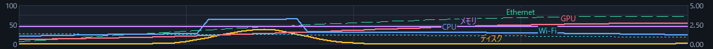
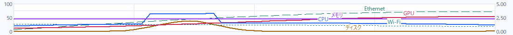

# Performance Glass

Windows 10 / 11（64bit）向けの軽量な常駐パフォーマンスモニターです。RustとWindows標準APIで動作します。

- CPU・メモリ・ディスク・Ethernet・Wi-Fi・GPUを1画面のグラフに重ねて表示
- 1分・10分・60分・6時間・12時間を切替、約1秒ごとに更新
- CPU速度、メモリ使用量、ディスク読み書き、通信の送受信、GPU専用メモリ使用量を表示
- 対応するCPU・GPU温度を表示し、取得できない項目は非表示
- Windowsのライト／ダーク配色とモニターごとのDPIに対応
- Windowsの表示言語に合わせて12言語へ自動切り替え（翻訳はEXE内蔵）
- グラフ専用表示は最小280×60物理px。トレイ格納中は描画を停止

## ダウンロード・起動

**[最新版をダウンロード（GitHub Releases）](https://github.com/nekomimiyks/PerformanceGlass/releases/latest)**

Assetsの `PerformanceGlass-v0.1.12-Windows-MSVC.zip` をすべて展開し、`PerformanceGlass.exe` をダブルクリックしてください。インストール・管理者権限・追加ランタイムは不要です。

配布ファイルはReleasesにまとめています。ZIPの内容はEXE・起動案内・ライセンス・第三者表記の4ファイルです。EXEには専用アイコンを内蔵しています。

Microsoft Store版（v0.1.10）は2026年11月18日（日本時間）に初回申請を送信し、現在は認定中です。認定に合格すると無料で公開されます。現時点では未公開で、GitHubの配布EXEは未署名です。Storeで配布されるMSIXには認定後にMicrosoft側の署名が適用されます。[MSIXのビルド手順と申請状況](store/README.md)、[プライバシーポリシー](docs/privacy.md)を公開しています。

### v0.1.12の変更

右クリックメニューの「言語」から、Windowsに合わせる自動設定と12言語を選べます。選択後は画面・メニュー・通知領域の説明・フォントが即座に切り替わり、次回起動にも引き継ぎます。各言語名は常に母語表記です。既存設定で言語指定がない場合は自動設定を使います。

### v0.1.11の変更

Windowsの表示言語の優先順に従い、日本語・英語・中国語（簡体字／繁体字）・韓国語・ドイツ語・フランス語・スペイン語・ポルトガル語・イタリア語・ロシア語・インドネシア語に自動切り替えます。メニュー、グラフ、数値の項目名、ホバー表示、通知領域の説明とエラー案内が対象です。対応する言語がなければ英語になります。中国語は台湾・香港・マカオを繁体字、中国本土・シンガポールを簡体字として扱い、明示的なHans/Hant指定を優先します。

言語の判定は起動時に1回だけ行います。Windowsの表示言語を変更した場合はアプリを終了して起動し直してください。翻訳ファイル・追加ランタイム・通信は不要で、ZIPは従来どおり4ファイルです。Storeで認定中の初回版はv0.1.10で、この多言語版とは別です。

### v0.1.10の変更

専用アイコンをEXE・ウィンドウ・通知領域へ組み込みました。Microsoft Store向けMSIXと、Store版での自動起動に対応しました。通常のZIP版の自動起動方式は従来どおりです。配布ZIPは起動に必要な4ファイルに整理し、詳細な説明と画像はGitHubにまとめました。

### v0.1.8の変更

Windows標準のMSVCツールチェーンによる比較版です。GitHub ActionsのWindows環境でソースからビルドし、単体テストとUI検証を実行しています。C/C++ランタイムはEXEに静的リンクしており、追加のランタイム導入は不要です。

計測・CPU温度連携・グラフ・常駐・自動起動などの機能は変更していません。配布環境の違いを確認するための比較版で、セキュリティーソフトによる隔離・削除の解消は未確認です。電子署名は付いていません。

### v0.1.7の変更

EXEに通常ユーザー権限での実行を明示するマニフェストと、製品名・開発者名・ファイルバージョンを追加しました。計測・温度取得・グラフ・常駐・自動起動など、アプリの機能は変更していません。

この変更は電子署名の追加ではありません。セキュリティーソフトや端末の管理ポリシーによる起動制限が解除されることを保証するものではありません。

## スクリーンショット

### 通常表示

期間選択・重ね合わせグラフ・下部の数値欄をまとめて表示します。

#### ダークモード


#### ライトモード


### グラフ専用表示

グラフをダブルクリックするとタイトルバー・期間操作・数値欄を隠せます。横長に縮めても、縦軸の数字と機器名は残ります。

#### ダークモード



#### ライトモード



Windowsのライト／ダーク設定に自動で合わせます。画像はアプリの見本データ表示です。数値は例で、実際には取得できる機器・温度だけを表示します。

## 操作

| 操作 | 動作 |
| --- | --- |
| グラフをダブルクリック / F11 | タイトルバー・期間操作・数値欄を隠す／戻す |
| グラフ専用表示でEsc | 通常表示へ戻す。薄すぎる場合は保存した通常サイズへ復帰 |
| 辺・角をドラッグ | 通常・グラフ専用とも縦横をリサイズ |
| グラフ専用表示の内側をドラッグ | ウィンドウを移動 |
| Alt + Space → サイズ変更 | 矢印キーでサイズ調整、Enterで確定 |
| 1 / 2 / 3 / 4 / 5 | 1分 / 10分 / 60分 / 6時間 / 12時間 |
| 下部の機器名をクリック | 対応する線の表示を切替 |
| グラフにマウスを置く | その時刻の数値・温度・読み書き速度を表示 |
| 右クリック / 設定 / F10 | 期間・系列・最前面・自動起動・終了を選択 |
| 右クリック → 言語 | Windowsに合わせる自動設定／12言語を選択。即時反映・次回にも保存 |
| T | 常に手前に表示する設定を切替 |
| × / 最小化 / 通常表示でEsc | トレイへ格納。計測は継続 |
| トレイアイコンをクリック | 表示／格納を切替 |

終了は右クリックメニューから行います。Windowsログオン時の自動起動は初期状態では無効です。

狭い幅や低い高さでは数値欄などを省略します。グラフ専用表示でも縦軸の数字は残します。最小のグラフ領域は280×60物理pxで、通常表示の外寸にはWindowsの枠とタイトルバーが加わります。

グラフ内の機器名は、表示中の項目だけを最小限の横間隔でまとめます。表示項目とウィンドウサイズが同じ間は横位置を固定し、各位置の線の値に合わせて上下だけ動きます。最新値が見えるよう右端は空けます。

## 指標と取得条件

- CPU使用率は全論理CPUの平均。CPU速度はWindowsの性能カウンターと基準クロックによる推定値です。
- メモリは物理RAMの使用率・使用量・総量（GiB）。RAMそのものの読み書き帯域は未対応です。
- ディスクの線は最も稼働中の物理ディスクのアクティブ時間。読み込み・書き込み速度は全物理ディスクの合計（MB/s）です。
- Ethernet・Wi-Fiは物理アダプターを種類ごとに合計します。線は送受信の合計Mbps、数値は送受信を別々に表示します。VPN・仮想アダプターは除外します。
- GPU使用率はプロセスごとの値を同じ物理エンジン単位で合算し、最も稼働中のエンジンを採用します。複数GPUの場合は最大値です。
- GPUメモリはWindowsのGPU Adapter Memoryカウンターによる専用メモリ使用量（GiB）。複数GPUは合計です。共有メモリ・搭載容量とは異なります。
- GPU温度は対応ドライバーのWDDMセンサーから取得します。複数GPUでは取得できた温度の最大値です。
- CPU温度は、起動済みのLibre Hardware Monitor / Open Hardware MonitorがWMIで公開するセンサー値を利用します。パッケージ・Tctl/Tdieを優先します。外部センサーは最大60秒で検出し、温度は約1秒ごとに読み取ります。センサーソフトやドライバーの自動導入はしません。

左軸は0～100%、右軸は通信速度Mbpsです。通信の倍率は表示期間の値に合わせて自動調整します。タスクマネージャーとは集計方法や計測時刻により差が出ます。

## 保存・軽量化

履歴は最大43,201点（約12時間）をメモリに保持し、終了時に消えます。位置・サイズ・期間などの設定は `%LOCALAPPDATA%\PerformanceGlass\settings.txt` に保存します。更新時はアプリを終了してEXEを置き換えてください。自動起動を有効にした後でEXEを移動した場合は、設定を解除して再登録してください。

計測はUIと別の1スレッドで実行します。GDIの描画バッファを再利用し、履歴を表示幅に集約して平均線と最小・最大値を描画します。毎秒の外部プロセス起動や常時アニメーションはありません。外部サーバーへの送信は行いません。

## ビルド・テスト

Rust stable（x86_64-pc-windows-gnu）・PowerShell・MinGWのリソースコンパイラー `windres.exe` を使用します。リソースコンパイラーは開発時のみ必要です。MinGWのbinをPATHに追加するか、環境変数 `WINDRES` に実行ファイルのパスを指定してください。

```powershell
.\build.ps1
cargo test --locked --target-dir "$env:TEMP\PerformanceGlass-build"
```

ビルド結果はリポジトリ直下の `PerformanceGlass.exe` です。MinGWの制約により、ビルド出力先には英数字のパスを指定してください。Windows性能カウンターの統合テストは、通常のWindows環境で実行します。

MSVC版はVisual Studio C++ Build ToolsとWindows SDKがある環境で、`RC` にリソースコンパイラーのパスを指定してビルドできます。

```powershell
.\build.ps1 -Target x86_64-pc-windows-msvc
```

GitHub Actionsの「Windows MSVC build」からも同じターゲットのビルドと検証を実行できます。EXEのビルド元は[実行記録](https://github.com/nekomimiyks/PerformanceGlass/actions/workflows/windows-build.yml)で確認できます。

見本表示は `--demo`、描画検証は `--demo --test-ui --qa-dir <出力先> --exit-after 8` で実行できます。検証モードは個人設定を保存しません。

依存ライブラリの表記は `THIRD_PARTY_NOTICES.txt` を参照してください。

## ライセンス

Performance Glassは[MITライセンス](LICENSE)で公開しています。著作権表示とライセンス文を保持すれば、改変・再配布・商用利用が可能です。依存ライブラリのライセンスは `THIRD_PARTY_NOTICES.txt` を参照してください。

## Code signing policy（コード署名方針）

無料の正規署名サービスへ申請しましたが、2026年11月17日に公開プロジェクトとしての認知・利用実績が不足しているため不承認となりました。実績が増えた後の再申請は可能と案内されています。現在の配布EXEは未署名です。[署名方針・担当者・プライバシー](docs/code-signing.md)を公開しています。
