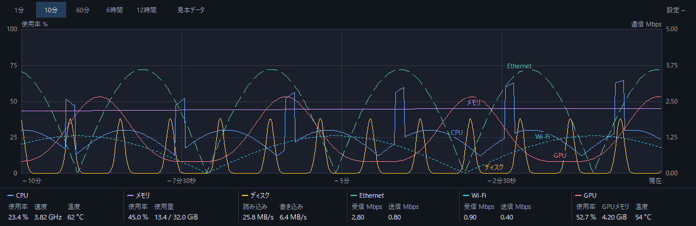
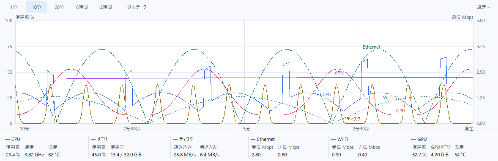

# Performance Glass

Windows 10 / 11（x64）向けの軽量な常駐パフォーマンスモニターです。

- CPU・メモリ・ディスク・Ethernet・Wi-Fi・GPUを1つのグラフに重ねて約1秒ごとに更新
- 表示期間は1分・10分・60分・6時間・12時間
- CPU速度、メモリ使用量、ディスク読み書き、通信の送受信、GPU専用メモリ、CPU・GPU温度を表示
- Windowsのライト／ダーク設定とDPIに対応。表示言語は12言語から自動選択または手動で切り替え

取得できない項目は非表示です。GitHub版では、右クリックの「CPU温度の計測」から有効にできます。対応するPawnIOが未導入の場合は、アプリで確認してから同梱の署名済み公式インストーラーを起動します。ドライバーの導入と、管理者権限が必要な計測には、Windowsの確認画面での許可が必要です。Libre Hardware Monitor・Open Hardware Monitorが公開する値も利用できます。[PawnIO](https://pawnio.eu/)

## ダウンロード

最新版のWindows用ZIPをすべて展開し、`PerformanceGlass.exe` を起動してください。基本機能はインストールや管理者権限なしで使えます。[GitHub Releases](https://github.com/nekomimiyks/PerformanceGlass/releases/latest)

GitHub版EXEは未署名です。[Microsoft Store版の詳細](store/README.md)

## スクリーンショット

| 表示 | ダーク | ライト |
| --- | --- | --- |
| 通常 |  |  |
| グラフ専用 |  |  |

## 操作

| 操作 | 動作 |
| --- | --- |
| グラフをダブルクリック／F11 | グラフの大きさと位置を保ったまま枠を切替 |
| 辺・角をドラッグ | サイズを変更。グラフ専用表示は最小280×60物理px |
| グラフ専用表示の内側をドラッグ | ウィンドウを移動 |
| グラフにマウスを置く | その時刻の数値を表示 |
| 右クリック／F10 | 期間・表示項目・言語・最前面・自動起動・終了 |
| 右クリック → タスクバーのグラフ | ミニグラフに表示する値を選択。既定はCPU使用率 |
| 右クリック → タスクトレイに常駐 | 有効にすると、×や最小化で通知領域に格納。既定はオフ |

常駐をオフにすると、×で終了し、最小化ではタスクバーに残ります。常駐中は通知領域のアイコンにもミニグラフを表示します。終了時のウィンドウ位置と表示設定は次回起動時に復元します。履歴はメモリに最大約12時間分を保持し、終了すると消えます。

## ソースからビルドする場合

以下の開発ツールは、ソースからEXEを作る場合にだけ必要です。配布ZIPのEXEは展開してそのまま使えます。

PowerShellとRustに加え、GNU版はMinGW（`windres.exe`を含む）、MSVC版はC++ Build ToolsとWindows SDKを用意してください。

```powershell
.\build.ps1
.\build.ps1 -Target x86_64-pc-windows-msvc
```

[性能測定](docs/performance.md) · [プライバシー](docs/privacy.md) · [コード署名](docs/code-signing.md) · [MITライセンス](LICENSE) · [第三者表記](THIRD_PARTY_NOTICES.txt)
