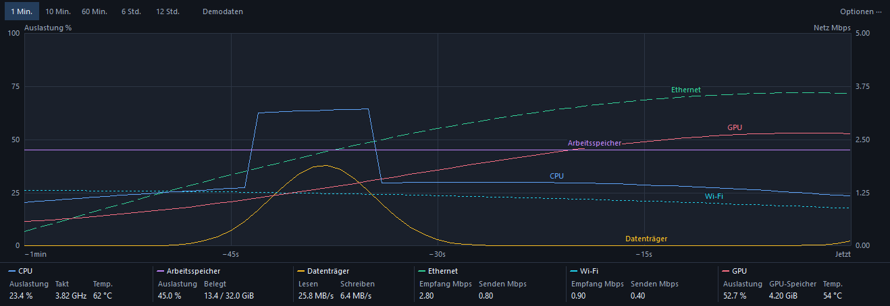
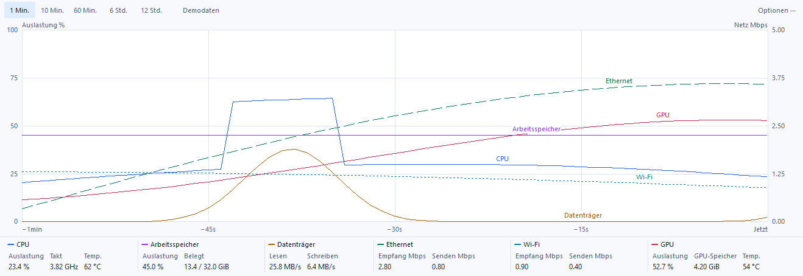
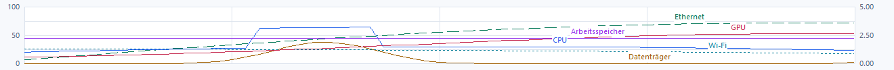

# Performance Glass

[日本語](../../README.md) · [English](README.en.md) · [简体中文](README.zh-Hans.md) · [繁體中文](README.zh-Hant.md) · [한국어](README.ko.md) · **Deutsch** · [Français](README.fr.md) · [Español](README.es.md) · [Português](README.pt.md) · [Italiano](README.it.md) · [Русский](README.ru.md) · [Bahasa Indonesia](README.id.md)

Ein schlanker Leistungsmonitor für Windows 10 und 11 (x64). Ein gemeinsames Diagramm zeigt CPU, Arbeitsspeicher, Datenträger, Ethernet, WLAN und GPU und wird etwa jede Sekunde aktualisiert.

Wähle 1, 10 oder 60 Minuten, 6 oder 12 Stunden. Angezeigt werden CPU-Takt, Speicherbelegung, Lese- und Schreibzugriffe, Netzwerkverkehr, dedizierter GPU-Speicher und verfügbare Temperaturen. Skalierung, Design und Sprache folgen Windows. Die Sprache lässt sich auch manuell wählen.

## Download

Starte die aktuelle Datei `PerformanceGlass-v*-Windows-x64-Setup.exe`. Wähle am Ende **Ja**, um die App zu starten, oder **Nein**, um die Installation zu beenden. Beim gleichen Windows-Konto bleiben die Einstellungen der ZIP-Version erhalten. Das GitHub-Installationsprogramm ist unsigniert.

[GitHub Releases](https://github.com/nekomimiyks/PerformanceGlass/releases/latest) · [Microsoft Store](https://apps.microsoft.com/detail/9PJ34ZZHSD01)

Das Installationsprogramm erstellt eine Desktopverknüpfung. In der GitHub-Version kannst du die automatische Updateprüfung im Kontextmenü einschalten. Sie ist standardmäßig aus. Wähle **Aktualisieren**, um das Installationsprogramm herunterzuladen, zu prüfen und zu starten.

Die CPU-Temperatur wird angezeigt, wenn ein laufender lokaler WMI-Anbieter mit den aktuellen Berechtigungen lesbar ist. Der CPU-Temperatur-Helfer der GitHub-Version ist standardmäßig deaktiviert. Die App fragt nur bei manueller Aktivierung nach der PawnIO-Installation oder nach Administratorrechten.

## Screenshots

Die Screenshots zeigen Beispieldaten.

### Normal (Dunkel)

### Normal (Hell)

### Nur Diagramm (Dunkel)

### Nur Diagramm (Hell)

## Einstellungen sichern und wiederherstellen

Wähle im Kontextmenü **Einstellungen sichern**, um eine `.pgbackup`-Datei zu speichern. Wähle **Einstellungen wiederherstellen**, öffne die Datei und bestätige, um die Anzeigeeinstellungen zu übernehmen. Messverlauf, Windows-Autostart und Administratorrechte sind nicht in der Sicherung enthalten.

## Bedienung

- Ein Doppelklick auf das Diagramm oder `F11` schaltet den Fensterrahmen um. Größe und Position des Diagramms bleiben erhalten.
- Ziehe an einer Kante oder Ecke, um die Größe anzupassen. Die reine Diagrammansicht ist bis auf 280 × 60 physische Pixel verkleinerbar.
- Zeige mit der Maus auf das Diagramm, um Messwerte zu sehen. Ein Rechtsklick oder `F10` öffnet Einstellungen für Verlauf, Sprache, Taskleistendiagramm und Infobereich. Der Infobereichsmodus ist standardmäßig aus.

[Datenschutzerklärung (Japanisch)](../privacy.md) · [MIT-Lizenz](../../LICENSE) · [Hinweise zu Drittanbietern](../../THIRD_PARTY_NOTICES.txt)
