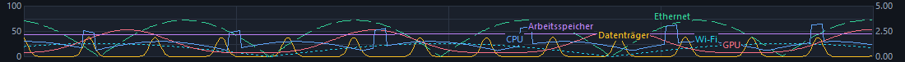

# Performance Glass

[日本語](../../README.md) · [English](README.en.md) · [简体中文](README.zh-Hans.md) · [繁體中文](README.zh-Hant.md) · [한국어](README.ko.md) · **Deutsch** · [Français](README.fr.md) · [Español](README.es.md) · [Português](README.pt.md) · [Italiano](README.it.md) · [Русский](README.ru.md) · [Bahasa Indonesia](README.id.md)

Ein schlanker Leistungsmonitor für Windows 10 und 11 (x64). Ein gemeinsames Diagramm zeigt CPU, Arbeitsspeicher, Datenträger, Ethernet, WLAN und GPU und wird etwa jede Sekunde aktualisiert.

Wähle 1, 10 oder 60 Minuten, 6 oder 12 Stunden. Angezeigt werden CPU-Takt, Speicherbelegung, Lese- und Schreibzugriffe, Netzwerkverkehr, dedizierter GPU-Speicher und verfügbare Temperaturen. Skalierung, Design und Sprache folgen Windows. Die Sprache lässt sich auch manuell wählen.

## Download

Entpacke die Windows-ZIP-Datei vollständig und starte `PerformanceGlass.exe`. Für die grundlegende Überwachung sind weder eine Installation noch Administratorrechte erforderlich. Die EXE auf GitHub ist unsigniert.

[GitHub Releases](https://github.com/nekomimiyks/PerformanceGlass/releases/latest) · [Microsoft Store](https://apps.microsoft.com/detail/9PJ34ZZHSD01)

Aktiviere **CPU-Temperatur messen** im Kontextmenü der GitHub-Version. Die App fragt nach, bevor sie das offizielle PawnIO-Installationsprogramm öffnet oder Administratorrechte anfordert. In der Store-Version erscheint die CPU-Temperatur, wenn ein kompatibler lokaler WMI-Anbieter sie liefert.

## Screenshots

Die Screenshots zeigen Beispieldaten.

| Ansicht | Dunkel | Hell |
| --- | --- | --- |
| Normal |  |  |
| Nur Diagramm |  |  |

## Bedienung

- Ein Doppelklick auf das Diagramm oder `F11` schaltet den Fensterrahmen um. Größe und Position des Diagramms bleiben erhalten.
- Ziehe an einer Kante oder Ecke, um die Größe anzupassen. Die reine Diagrammansicht ist bis auf 280 × 60 physische Pixel verkleinerbar.
- Zeige mit der Maus auf das Diagramm, um Messwerte zu sehen. Ein Rechtsklick oder `F10` öffnet Einstellungen für Verlauf, Sprache, Taskleistendiagramm und Infobereich. Der Infobereichsmodus ist standardmäßig aus.

[Datenschutzerklärung (Japanisch)](../privacy.md) · [MIT-Lizenz](../../LICENSE) · [Hinweise zu Drittanbietern](../../THIRD_PARTY_NOTICES.txt)
