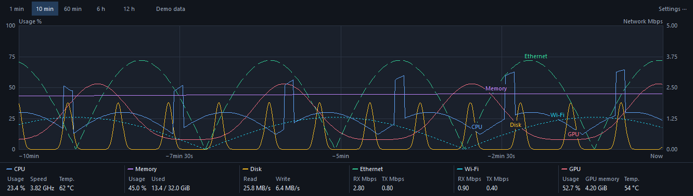
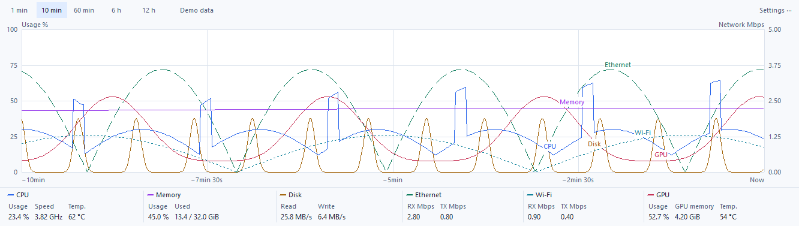
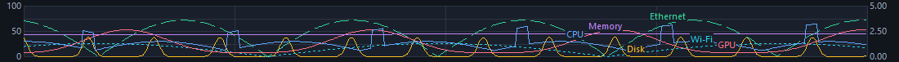
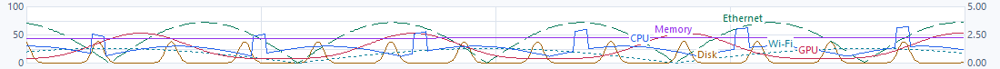

# Performance Glass

[日本語](../../README.md) · **English** · [简体中文](README.zh-Hans.md) · [繁體中文](README.zh-Hant.md) · [한국어](README.ko.md) · [Deutsch](README.de.md) · [Français](README.fr.md) · [Español](README.es.md) · [Português](README.pt.md) · [Italiano](README.it.md) · [Русский](README.ru.md) · [Bahasa Indonesia](README.id.md)

A lightweight desktop performance monitor for Windows 10 and 11 (x64). One chart tracks CPU, memory, disk, Ethernet, Wi-Fi and GPU activity, with updates about once a second.

Choose a history range of 1 min, 10 min, 60 min, 6 h or 12 h. Read CPU speed, memory usage, disk reads and writes, network traffic, dedicated GPU memory and temperatures when available. The app follows Windows display scaling, theme and language. You can also select the interface language manually.

## Download

Extract the Windows ZIP and run `PerformanceGlass.exe`. Basic monitoring requires no installation or administrator access. The GitHub executable is unsigned.

[GitHub Releases](https://github.com/nekomimiyks/PerformanceGlass/releases/latest) · [Microsoft Store](https://apps.microsoft.com/detail/9PJ34ZZHSD01)

Right-click and choose **CPU temperature monitoring** to use the bundled helper in the GitHub build. The app asks before opening the official PawnIO installer or requesting administrator access. The Store build shows CPU temperature when a compatible local WMI provider supplies it.

## Screenshots

Screenshots use sample data.

| View | Dark | Light |
| --- | --- | --- |
| Normal |  |  |
| Chart only |  |  |

## Controls

- Double-click the chart or press `F11` to toggle the frame without moving or resizing the chart.
- Drag an edge or corner to resize. Chart-only mode can shrink to 280 × 60 physical pixels.
- Hover over the chart to read values. Right-click or press `F10` for history ranges, language, taskbar graph and optional system tray mode. Tray mode is off by default.

[Privacy policy (Japanese)](../privacy.md) · [MIT license](../../LICENSE) · [Third-party notices](../../THIRD_PARTY_NOTICES.txt)
