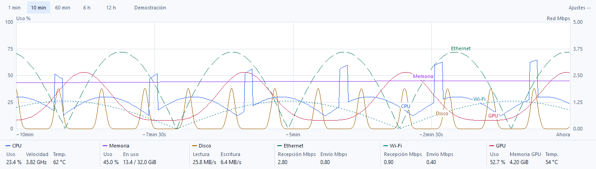

# Performance Glass

[日本語](../../README.md) · [English](README.en.md) · [简体中文](README.zh-Hans.md) · [繁體中文](README.zh-Hant.md) · [한국어](README.ko.md) · [Deutsch](README.de.md) · [Français](README.fr.md) · **Español** · [Português](README.pt.md) · [Italiano](README.it.md) · [Русский](README.ru.md) · [Bahasa Indonesia](README.id.md)

Monitor de rendimiento ligero para Windows 10 y 11 (x64). Un gráfico reúne la actividad de la CPU, la memoria, el disco, Ethernet, Wi-Fi y la GPU, con datos nuevos aproximadamente cada segundo.

Elige un intervalo de 1, 10 o 60 minutos, o de 6 o 12 horas. Consulta la velocidad de la CPU, el uso de memoria, las lecturas y escrituras de disco, el tráfico de red, la memoria dedicada de la GPU y las temperaturas disponibles. La aplicación sigue la escala, el tema y el idioma de Windows. También permite elegir el idioma manualmente.

## Descarga

Extrae todo el ZIP de Windows y ejecuta `PerformanceGlass.exe`. La monitorización básica funciona sin instalación ni permisos de administrador. El EXE de GitHub no está firmado.

[GitHub Releases](https://github.com/nekomimiyks/PerformanceGlass/releases/latest) · [Microsoft Store](https://apps.microsoft.com/detail/9PJ34ZZHSD01)

En la versión de GitHub, selecciona **Medir la temperatura de la CPU** en el menú contextual. La aplicación pide confirmación antes de abrir el instalador oficial de PawnIO o solicitar permisos de administrador. La versión de Store muestra la temperatura cuando la facilita un proveedor WMI local compatible.

## Capturas de pantalla

Las capturas usan datos de ejemplo.

| Vista | Oscuro | Claro |
| --- | --- | --- |
| Normal |  |  |
| Solo gráfico |  |  |

## Controles

- Haz doble clic en el gráfico o pulsa `F11` para alternar el marco sin mover ni cambiar el tamaño del gráfico.
- Arrastra un borde o una esquina para cambiar el tamaño. El modo de solo gráfico permite reducirlo a 280 × 60 píxeles físicos.
- Sitúa el cursor sobre el gráfico para ver valores. Haz clic derecho o pulsa `F10` para ajustar el historial, el idioma, el gráfico de la barra de tareas y la bandeja del sistema. La bandeja está desactivada de forma predeterminada.

[Política de privacidad (japonés)](../privacy.md) · [Licencia MIT](../../LICENSE) · [Avisos de terceros](../../THIRD_PARTY_NOTICES.txt)
