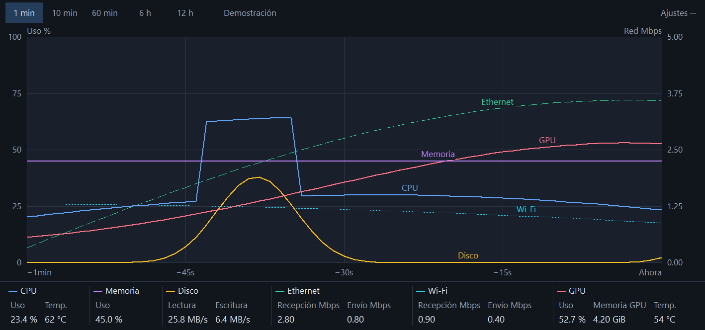
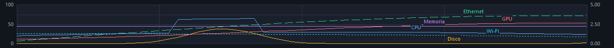
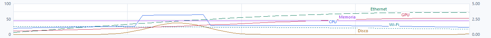

# Performance Glass

[日本語](../../README.md) · [English](README.en.md) · [简体中文](README.zh-Hans.md) · [繁體中文](README.zh-Hant.md) · [한국어](README.ko.md) · [Deutsch](README.de.md) · [Français](README.fr.md) · **Español** · [Português](README.pt.md) · [Italiano](README.it.md) · [Русский](README.ru.md) · [Bahasa Indonesia](README.id.md)

Monitor de rendimiento ligero para Windows 10 y 11 (x64). Un gráfico reúne la actividad de la CPU, la memoria, el disco, Ethernet, Wi-Fi y la GPU, con datos nuevos aproximadamente cada segundo.

Elige un intervalo de 1, 10 o 60 minutos, o de 6 o 12 horas. Consulta la velocidad de la CPU, el uso de memoria, las lecturas y escrituras de disco, el tráfico de red, la memoria dedicada de la GPU y las temperaturas disponibles. La aplicación sigue la escala, el tema y el idioma de Windows. También permite elegir el idioma manualmente.

## Descarga

Ejecuta el archivo más reciente `PerformanceGlass-v*-Windows-x64-Setup.exe`. Al finalizar, elige **Sí** para iniciar la aplicación o **No** para cerrar. Se conservan los ajustes de la versión ZIP si usas la misma cuenta de Windows. El instalador de GitHub no está firmado.

[GitHub Releases](https://github.com/nekomimiyks/PerformanceGlass/releases/latest) · [Microsoft Store](https://apps.microsoft.com/detail/9PJ34ZZHSD01)

El instalador crea un acceso directo en el escritorio. En la versión de GitHub, puedes activar la búsqueda automática de actualizaciones desde el menú contextual. Está desactivada de forma predeterminada. Selecciona **Actualizar** para descargar, verificar y ejecutar el instalador.

La temperatura de la CPU se muestra si la aplicación puede leer un proveedor WMI local compatible en ejecución con sus permisos actuales. El asistente de temperatura de la edición de GitHub está desactivado de forma predeterminada. La aplicación solo ofrece instalar PawnIO o solicitar permisos de administrador al activarlo manualmente.

## Capturas de pantalla

Las capturas usan datos de ejemplo.

### Normal (Oscuro)

### Normal (Claro)

### Solo gráfico (Oscuro)

### Solo gráfico (Claro)

## Copia de seguridad y restauración

Haz clic derecho y selecciona **Hacer copia de seguridad de la configuración** para guardar un archivo `.pgbackup`. Selecciona **Restaurar la configuración**, abre el archivo y confirma para aplicar los ajustes de visualización. La copia excluye el historial de mediciones, el inicio con Windows y los permisos de administrador.

## Controles

- Haz doble clic en el gráfico o pulsa `F11` para alternar el marco sin mover ni cambiar el tamaño del gráfico.
- Arrastra un borde o una esquina para cambiar el tamaño. El modo de solo gráfico permite reducirlo a 280 × 60 píxeles físicos.
- Sitúa el cursor sobre el gráfico para ver valores. Haz clic derecho o pulsa `F10` para ajustar el historial, el idioma, el gráfico de la barra de tareas y la bandeja del sistema. La bandeja está desactivada de forma predeterminada.

«Acerca de esta aplicación» en el menú contextual muestra la versión en ejecución y enlaces a las aplicaciones del editor en GitHub y Microsoft Store.

[Política de privacidad (japonés)](../privacy.md) · [Licencia MIT](../../LICENSE) · [Avisos de terceros](../../THIRD_PARTY_NOTICES.txt)
