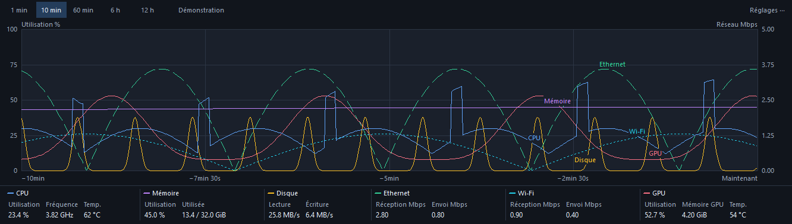
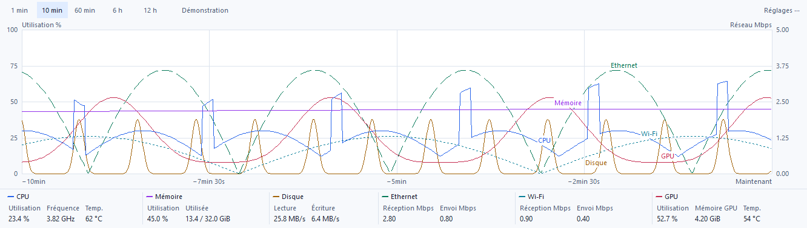
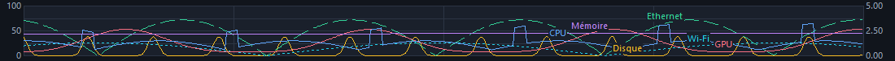
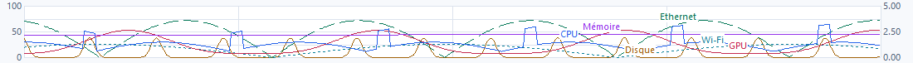

# Performance Glass

[日本語](../../README.md) · [English](README.en.md) · [简体中文](README.zh-Hans.md) · [繁體中文](README.zh-Hant.md) · [한국어](README.ko.md) · [Deutsch](README.de.md) · **Français** · [Español](README.es.md) · [Português](README.pt.md) · [Italiano](README.it.md) · [Русский](README.ru.md) · [Bahasa Indonesia](README.id.md)

Un outil léger de suivi des performances pour Windows 10 et 11 (x64). Un graphique commun présente le processeur, la mémoire, les disques, Ethernet, le Wi-Fi et le GPU, avec une mise à jour environ toutes les secondes.

Choisissez une période de 1, 10 ou 60 minutes, ou de 6 ou 12 heures. Consultez la fréquence du processeur, la mémoire utilisée, les lectures et écritures disque, le trafic réseau, la mémoire vidéo dédiée et les températures disponibles. L’application suit la mise à l’échelle, le thème et la langue de Windows. La langue se choisit aussi manuellement.

## Téléchargement

Extrayez entièrement le ZIP Windows et lancez `PerformanceGlass.exe`. La surveillance de base fonctionne sans installation ni droits administrateur. L’EXE GitHub n’est pas signé.

[GitHub Releases](https://github.com/nekomimiyks/PerformanceGlass/releases/latest) · [Microsoft Store](https://apps.microsoft.com/detail/9PJ34ZZHSD01)

Dans la version GitHub, ouvrez le menu contextuel et choisissez **Mesurer la température du processeur**. L’application demande une confirmation avant d’ouvrir le programme d’installation officiel de PawnIO ou de demander les droits administrateur. La version Store affiche la température du processeur si un fournisseur WMI local compatible la transmet.

## Captures d’écran

Les captures utilisent des données d’exemple.

| Affichage | Sombre | Clair |
| --- | --- | --- |
| Normal |  |  |
| Graphique seul |  |  |

## Commandes

- Double-cliquez sur le graphique ou appuyez sur `F11` pour basculer le cadre sans déplacer ni redimensionner le graphique.
- Faites glisser un bord ou un coin pour redimensionner la fenêtre. Le mode graphique seul peut descendre à 280 × 60 pixels physiques.
- Survolez le graphique pour lire les valeurs. Un clic droit ou `F10` ouvre les réglages de période, langue, graphique de la barre des tâches et zone de notification. Le mode zone de notification est désactivé par défaut.

[Politique de confidentialité (japonais)](../privacy.md) · [Licence MIT](../../LICENSE) · [Mentions de tiers](../../THIRD_PARTY_NOTICES.txt)
