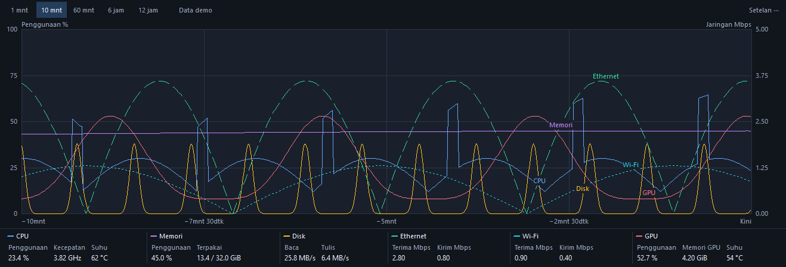
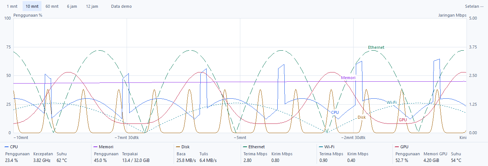
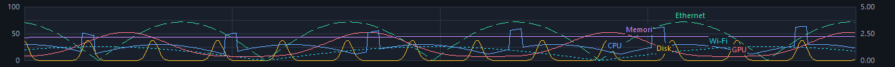
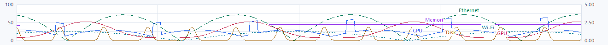

# Performance Glass

[日本語](../../README.md) · [English](README.en.md) · [简体中文](README.zh-Hans.md) · [繁體中文](README.zh-Hant.md) · [한국어](README.ko.md) · [Deutsch](README.de.md) · [Français](README.fr.md) · [Español](README.es.md) · [Português](README.pt.md) · [Italiano](README.it.md) · [Русский](README.ru.md) · **Bahasa Indonesia**

Pemantau kinerja desktop ringan untuk Windows 10 dan 11 (x64). Satu grafik menampilkan aktivitas CPU, memori, disk, Ethernet, Wi-Fi, dan GPU dengan pembaruan sekitar sekali per detik.

Pilih riwayat 1, 10, atau 60 menit, atau 6 atau 12 jam. Lihat kecepatan CPU, penggunaan memori, baca dan tulis disk, lalu lintas jaringan, memori GPU khusus, dan suhu yang tersedia. Aplikasi mengikuti skala, tema, dan bahasa Windows. Bahasa antarmuka juga dapat dipilih secara manual.

## Unduh

Jalankan `PerformanceGlass-v*-Windows-x64-Setup.exe` versi terbaru. Setelah penginstalan, pilih **Ya** untuk menjalankan aplikasi atau **Tidak** untuk keluar. Pengaturan versi ZIP tetap tersedia untuk akun Windows yang sama. Penginstal GitHub tidak bertanda tangan digital.

[GitHub Releases](https://github.com/nekomimiyks/PerformanceGlass/releases/latest) · [Microsoft Store](https://apps.microsoft.com/detail/9PJ34ZZHSD01)

Pada versi GitHub, pilih **Pantau suhu CPU** dari menu klik kanan. Aplikasi meminta konfirmasi sebelum membuka penginstal resmi PawnIO atau meminta akses administrator. Versi Store menampilkan suhu CPU jika tersedia dari penyedia WMI lokal yang kompatibel.

## Tangkapan layar

Tangkapan layar menggunakan data contoh.

### Normal (Gelap)

### Normal (Terang)

### Grafik saja (Gelap)

### Grafik saja (Terang)

## Cadangkan dan pulihkan pengaturan

Klik kanan dan pilih **Cadangkan pengaturan** untuk menyimpan berkas `.pgbackup`. Pilih **Pulihkan pengaturan**, buka berkas, lalu konfirmasi untuk menerapkan pengaturan tampilan. Cadangan tidak mencakup riwayat pengukuran, startup Windows, atau pilihan akses administrator.

## Kontrol

- Klik dua kali grafik atau tekan `F11` untuk mengalihkan bingkai tanpa mengubah ukuran dan posisi grafik.
- Tarik tepi atau sudut untuk mengubah ukuran. Mode grafik saja dapat diperkecil hingga 280 × 60 piksel fisik.
- Arahkan kursor ke grafik untuk melihat nilai. Klik kanan atau tekan `F10` untuk pengaturan riwayat, bahasa, grafik bilah tugas, dan baki sistem. Mode baki sistem secara bawaan nonaktif.

[Kebijakan privasi (bahasa Jepang)](../privacy.md) · [Lisensi MIT](../../LICENSE) · [Pemberitahuan pihak ketiga](../../THIRD_PARTY_NOTICES.txt)
