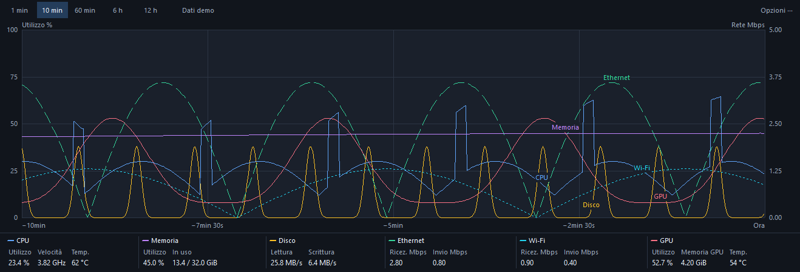
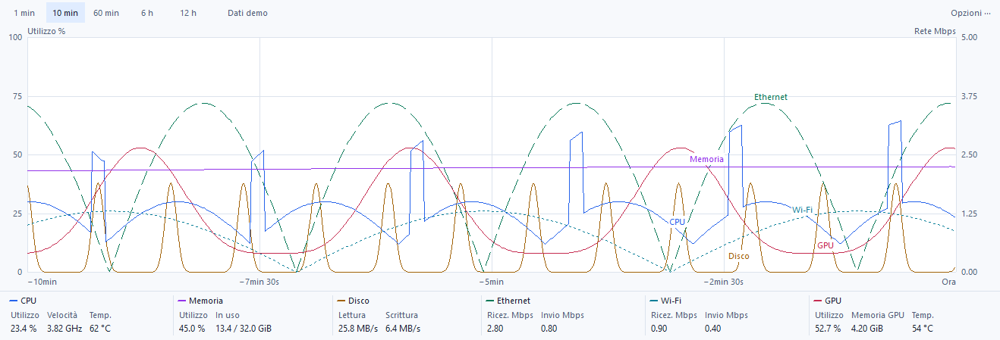
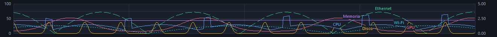
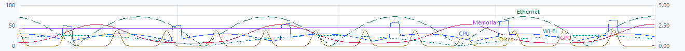

# Performance Glass

[日本語](../../README.md) · [English](README.en.md) · [简体中文](README.zh-Hans.md) · [繁體中文](README.zh-Hant.md) · [한국어](README.ko.md) · [Deutsch](README.de.md) · [Français](README.fr.md) · [Español](README.es.md) · [Português](README.pt.md) · **Italiano** · [Русский](README.ru.md) · [Bahasa Indonesia](README.id.md)

Monitor delle prestazioni leggero per Windows 10 e 11 (x64). Un unico grafico mostra attività di CPU, memoria, disco, Ethernet, Wi-Fi e GPU, con aggiornamenti circa ogni secondo.

Scegli un intervallo di 1, 10 o 60 minuti, oppure di 6 o 12 ore. Consulta frequenza della CPU, memoria usata, letture e scritture su disco, traffico di rete, memoria GPU dedicata e temperature disponibili. L’app segue scala, tema e lingua di Windows. La lingua si può anche scegliere manualmente.

## Scarica

Avvia l’ultima versione di `PerformanceGlass-v*-Windows-x64-Setup.exe`. Al termine, scegli **Sì** per avviare l’app o **No** per uscire. Con lo stesso account Windows, le impostazioni della versione ZIP vengono conservate. Il programma di installazione di GitHub non è firmato.

[GitHub Releases](https://github.com/nekomimiyks/PerformanceGlass/releases/latest) · [Microsoft Store](https://apps.microsoft.com/detail/9PJ34ZZHSD01)

Nella versione GitHub, seleziona **Misura temperatura CPU** dal menu contestuale. L’app chiede conferma prima di aprire il programma di installazione ufficiale di PawnIO o di richiedere i diritti di amministratore. La versione Store mostra la temperatura della CPU se la fornisce un provider WMI locale compatibile.

## Screenshot

Gli screenshot mostrano dati di esempio.

### Normale (Scuro)

### Normale (Chiaro)

### Solo grafico (Scuro)

### Solo grafico (Chiaro)

## Backup e ripristino delle impostazioni

Fai clic con il tasto destro e scegli **Salva backup delle impostazioni** per salvare un file `.pgbackup`. Scegli **Ripristina impostazioni**, apri il file e conferma per applicare le preferenze di visualizzazione. Il backup esclude la cronologia delle misurazioni, l’avvio con Windows e le scelte sui diritti di amministratore.

## Comandi

- Fai doppio clic sul grafico o premi `F11` per mostrare o nascondere la cornice mantenendo dimensioni e posizione del grafico.
- Trascina un bordo o un angolo per ridimensionare la finestra. La modalità solo grafico può scendere a 280 × 60 pixel fisici.
- Passa il puntatore sul grafico per vedere i valori. Usa il tasto destro o `F10` per impostare cronologia, lingua, grafico della barra delle applicazioni e area di notifica. La modalità nell’area di notifica è disattivata in modo predefinito.

[Informativa sulla privacy (giapponese)](../privacy.md) · [Licenza MIT](../../LICENSE) · [Avvisi di terze parti](../../THIRD_PARTY_NOTICES.txt)
