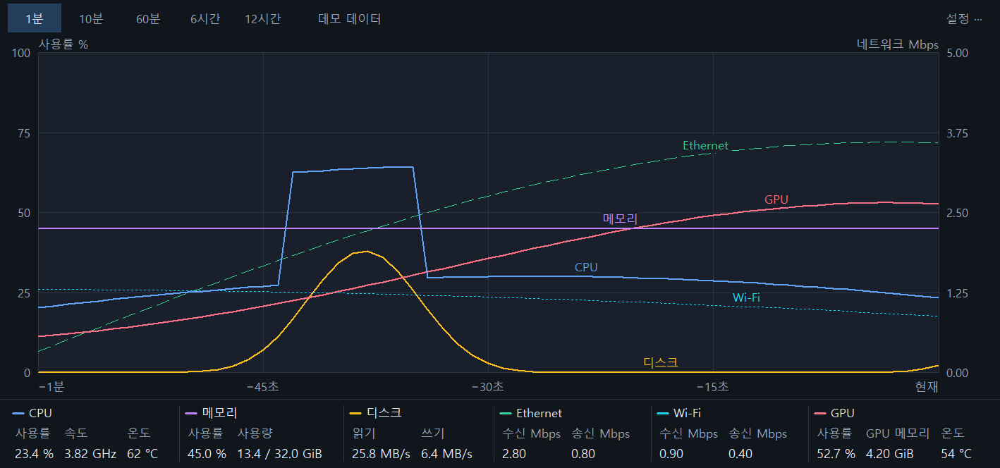
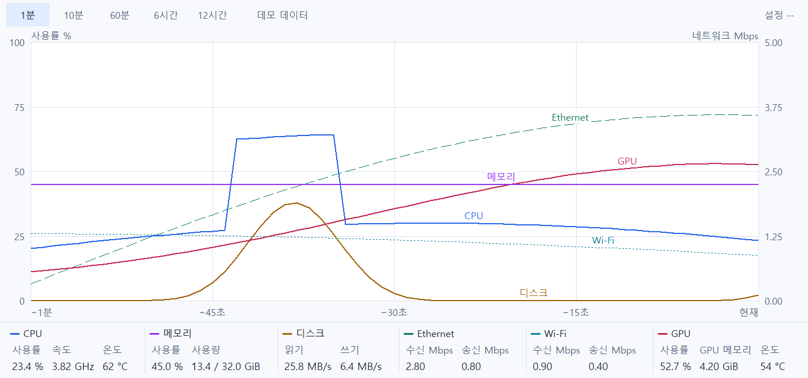
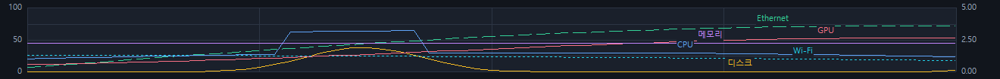
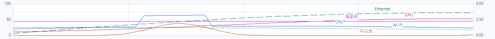

# Performance Glass

[日本語](../../README.md) · [English](README.en.md) · [简体中文](README.zh-Hans.md) · [繁體中文](README.zh-Hant.md) · **한국어** · [Deutsch](README.de.md) · [Français](README.fr.md) · [Español](README.es.md) · [Português](README.pt.md) · [Italiano](README.it.md) · [Русский](README.ru.md) · [Bahasa Indonesia](README.id.md)

Windows 10 및 11(x64)용 경량 데스크톱 성능 모니터입니다. CPU, 메모리, 디스크, 이더넷, Wi-Fi 및 GPU 활동을 한 그래프로 보여 주며 약 1초마다 갱신합니다.

1분, 10분, 60분, 6시간 또는 12시간 기록을 볼 수 있습니다. CPU 속도, 메모리 사용량, 디스크 읽기·쓰기, 네트워크 트래픽, 전용 GPU 메모리와 지원되는 온도를 확인할 수 있습니다. Windows의 배율, 테마, 표시 언어를 따르며 언어를 직접 선택할 수도 있습니다.

## 다운로드

최신 `PerformanceGlass-v*-Windows-x64-Setup.exe`를 실행하세요. 설치가 끝나면 **예**를 선택해 앱을 시작하거나 **아니요**를 선택해 종료할 수 있습니다. 같은 Windows 사용자 계정에서는 기존 ZIP 버전의 설정이 유지됩니다. GitHub 설치 프로그램은 서명되지 않았습니다.

[GitHub Releases](https://github.com/nekomimiyks/PerformanceGlass/releases/latest) · [Microsoft Store](https://apps.microsoft.com/detail/9PJ34ZZHSD01)

설치 프로그램은 바탕 화면 바로 가기를 만듭니다. GitHub 버전의 오른쪽 클릭 메뉴에서 기본값이 꺼짐인 자동 업데이트 확인을 켤 수 있습니다. 새 버전이 있으면 **업데이트**를 선택해 설치 프로그램을 다운로드하고 검증한 뒤 실행합니다.

실행 중인 호환 로컬 WMI 공급자를 현재 권한으로 읽을 수 있으면 CPU 온도가 표시됩니다. GitHub 버전의 CPU 온도 도우미는 기본적으로 꺼져 있습니다. 도우미를 직접 켰을 때만 PawnIO 설치 또는 관리자 권한을 요청합니다.

## 스크린샷

스크린샷은 예제 데이터를 사용합니다.

### 일반 (어두운 테마)

### 일반 (밝은 테마)

### 그래프만 표시 (어두운 테마)

### 그래프만 표시 (밝은 테마)

## 설정 백업 및 복원

마우스 오른쪽 버튼을 눌러 **설정 백업**을 선택하고 `.pgbackup` 파일을 저장하세요. **설정 복원**에서 파일을 열고 확인하면 저장된 표시 설정이 적용됩니다. 측정 기록, Windows 자동 시작 및 관리자 권한 선택은 백업에 포함되지 않습니다.

## 조작

- 그래프를 두 번 클릭하거나 `F11`을 눌러 그래프 크기와 위치를 유지하면서 창 테두리를 전환합니다.
- 창 가장자리나 모서리를 드래그하여 크기를 조정합니다. 그래프 전용 보기의 최소 크기는 물리 픽셀 기준 280 × 60입니다.
- 그래프에 마우스를 올리면 값을 확인할 수 있습니다. 마우스 오른쪽 버튼 또는 `F10`으로 기록 범위, 언어, 작업 표시줄 그래프, 트레이 상주를 설정합니다. 트레이 상주는 기본적으로 꺼져 있습니다.

오른쪽 클릭 메뉴의 ‘이 앱 정보’에서 실행 중인 버전과 GitHub 및 Microsoft Store에 공개된 앱의 링크를 확인할 수 있습니다.

[개인정보 처리방침(일본어)](../privacy.md) · [MIT 라이선스](../../LICENSE) · [타사 고지](../../THIRD_PARTY_NOTICES.txt)
