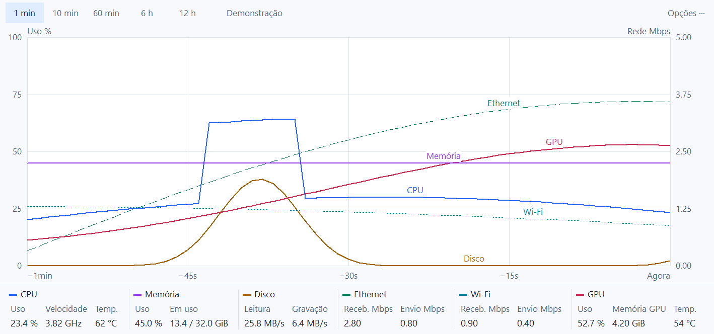
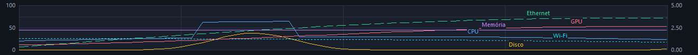

# Performance Glass

[日本語](../../README.md) · [English](README.en.md) · [简体中文](README.zh-Hans.md) · [繁體中文](README.zh-Hant.md) · [한국어](README.ko.md) · [Deutsch](README.de.md) · [Français](README.fr.md) · [Español](README.es.md) · **Português** · [Italiano](README.it.md) · [Русский](README.ru.md) · [Bahasa Indonesia](README.id.md)

Monitor de desempenho leve para Windows 10 e 11 (x64). Um único gráfico reúne CPU, memória, disco, Ethernet, Wi-Fi e GPU, com atualização aproximadamente a cada segundo.

Escolha o histórico de 1, 10 ou 60 minutos, ou de 6 ou 12 horas. Consulte frequência da CPU, uso de memória, leituras e gravações em disco, tráfego de rede, memória dedicada da GPU e temperaturas disponíveis. A interface segue a escala, o tema e o idioma do Windows. Também é possível escolher o idioma manualmente.

## Download

Execute o arquivo mais recente `PerformanceGlass-v*-Windows-x64-Setup.exe`. Ao terminar, escolha **Sim** para abrir o aplicativo ou **Não** para sair. As configurações da versão ZIP são mantidas na mesma conta do Windows. O instalador do GitHub não é assinado.

[GitHub Releases](https://github.com/nekomimiyks/PerformanceGlass/releases/latest) · [Microsoft Store](https://apps.microsoft.com/detail/9PJ34ZZHSD01)

O instalador cria um atalho na área de trabalho. Na versão do GitHub, você pode ativar a verificação automática de atualizações no menu de contexto. Ela vem desativada. Selecione **Atualizar** para baixar, verificar e executar o instalador.

A temperatura da CPU aparece quando o aplicativo pode ler um provedor WMI local compatível em execução com as permissões atuais. O assistente de temperatura da versão do GitHub vem desativado. O aplicativo só oferece a instalação do PawnIO ou solicita acesso de administrador ao ativá-lo manualmente.

## Capturas de tela

As capturas usam dados de exemplo.

### Normal (Escuro)

### Normal (Claro)

### Somente gráfico (Escuro)

### Somente gráfico (Claro)

## Backup e restauração de configurações

Clique com o botão direito e escolha **Fazer backup das configurações** para salvar um arquivo `.pgbackup`. Escolha **Restaurar configurações**, abra o arquivo e confirme para aplicar as preferências de exibição. O backup não inclui o histórico de medições, a inicialização com o Windows nem as escolhas de acesso de administrador.

## Controles

- Clique duas vezes no gráfico ou pressione `F11` para alternar a moldura sem mudar a posição ou o tamanho do gráfico.
- Arraste uma borda ou um canto para redimensionar. No modo somente gráfico, o tamanho mínimo é de 280 × 60 pixels físicos.
- Passe o cursor sobre o gráfico para ver os valores. Clique com o botão direito ou pressione `F10` para ajustar histórico, idioma, gráfico da barra de tarefas e bandeja do sistema. O modo bandeja vem desativado.

A opção “Sobre este aplicativo” no menu de contexto mostra a versão em execução e links para os aplicativos do editor no GitHub e na Microsoft Store.

[Política de privacidade (japonês)](../privacy.md) · [Licença MIT](../../LICENSE) · [Avisos de terceiros](../../THIRD_PARTY_NOTICES.txt)
