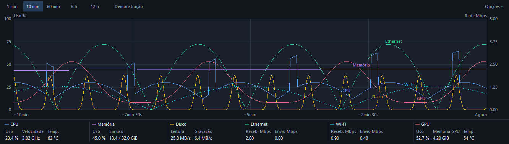
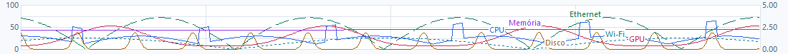

# Performance Glass

[日本語](../../README.md) · [English](README.en.md) · [简体中文](README.zh-Hans.md) · [繁體中文](README.zh-Hant.md) · [한국어](README.ko.md) · [Deutsch](README.de.md) · [Français](README.fr.md) · [Español](README.es.md) · **Português** · [Italiano](README.it.md) · [Русский](README.ru.md) · [Bahasa Indonesia](README.id.md)

Monitor de desempenho leve para Windows 10 e 11 (x64). Um único gráfico reúne CPU, memória, disco, Ethernet, Wi-Fi e GPU, com atualização aproximadamente a cada segundo.

Escolha o histórico de 1, 10 ou 60 minutos, ou de 6 ou 12 horas. Consulte frequência da CPU, uso de memória, leituras e gravações em disco, tráfego de rede, memória dedicada da GPU e temperaturas disponíveis. A interface segue a escala, o tema e o idioma do Windows. Também é possível escolher o idioma manualmente.

## Download

Extraia todo o ZIP do Windows e execute `PerformanceGlass.exe`. O monitoramento básico funciona sem instalação nem permissões de administrador. O EXE do GitHub não é assinado.

[GitHub Releases](https://github.com/nekomimiyks/PerformanceGlass/releases/latest) · [Microsoft Store](https://apps.microsoft.com/detail/9PJ34ZZHSD01)

Na versão do GitHub, selecione **Monitorar a temperatura da CPU** no menu de contexto. O aplicativo pede confirmação antes de abrir o instalador oficial do PawnIO ou solicitar permissões de administrador. A versão da Microsoft Store mostra a temperatura da CPU quando um provedor WMI local compatível fornece o dado.

## Capturas de tela

As capturas usam dados de exemplo.

| Modo | Escuro | Claro |
| --- | --- | --- |
| Normal |  |  |
| Somente gráfico |  |  |

## Controles

- Clique duas vezes no gráfico ou pressione `F11` para alternar a moldura sem mudar a posição ou o tamanho do gráfico.
- Arraste uma borda ou um canto para redimensionar. No modo somente gráfico, o tamanho mínimo é de 280 × 60 pixels físicos.
- Passe o cursor sobre o gráfico para ver os valores. Clique com o botão direito ou pressione `F10` para ajustar histórico, idioma, gráfico da barra de tarefas e bandeja do sistema. O modo bandeja vem desativado.

[Política de privacidade (japonês)](../privacy.md) · [Licença MIT](../../LICENSE) · [Avisos de terceiros](../../THIRD_PARTY_NOTICES.txt)
