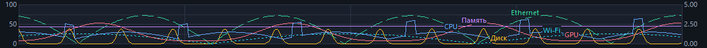

# Performance Glass

[日本語](../../README.md) · [English](README.en.md) · [简体中文](README.zh-Hans.md) · [繁體中文](README.zh-Hant.md) · [한국어](README.ko.md) · [Deutsch](README.de.md) · [Français](README.fr.md) · [Español](README.es.md) · [Português](README.pt.md) · [Italiano](README.it.md) · **Русский** · [Bahasa Indonesia](README.id.md)

Лёгкий монитор производительности для Windows 10 и 11 (x64). Один график показывает активность процессора, памяти, диска, Ethernet, Wi-Fi и GPU. Данные обновляются примерно раз в секунду.

Доступны интервалы 1, 10 и 60 минут, 6 и 12 часов. Приложение показывает частоту процессора, использование памяти, чтение и запись на диск, сетевой трафик, выделенную видеопамять и доступные температуры. Интерфейс учитывает масштаб, тему и язык Windows. Язык можно выбрать вручную.

## Скачать

Полностью распакуйте ZIP для Windows и запустите `PerformanceGlass.exe`. Для основного мониторинга установка и права администратора не нужны. EXE с GitHub не подписан.

[GitHub Releases](https://github.com/nekomimiyks/PerformanceGlass/releases/latest) · [Microsoft Store](https://apps.microsoft.com/detail/9PJ34ZZHSD01)

В версии с GitHub выберите **Измерять температуру процессора** в контекстном меню. Приложение запрашивает подтверждение перед запуском официального установщика PawnIO или запросом прав администратора. Версия из Microsoft Store показывает температуру процессора, если её передаёт совместимый локальный поставщик WMI.

## Снимки экрана

На снимках показаны демонстрационные данные.

| Режим | Тёмный | Светлый |
| --- | --- | --- |
| Обычный |  |  |
| Только график |  |  |

## Управление

- Дважды щёлкните по графику или нажмите `F11`, чтобы переключить рамку окна, сохранив размер и положение графика.
- Перетащите край или угол для изменения размера. Минимальный размер в режиме графика — 280 × 60 физических пикселей.
- Наведите курсор на график, чтобы увидеть значения. Щелчок правой кнопкой или `F10` открывает настройки истории, языка, графика на панели задач и области уведомлений. Режим области уведомлений выключен по умолчанию.

[Политика конфиденциальности (японский)](../privacy.md) · [Лицензия MIT](../../LICENSE) · [Уведомления о сторонних компонентах](../../THIRD_PARTY_NOTICES.txt)
