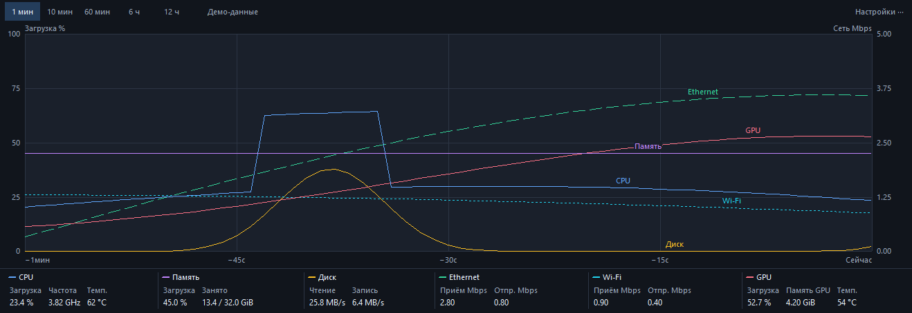
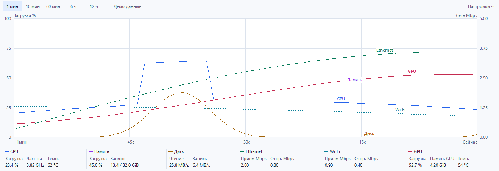
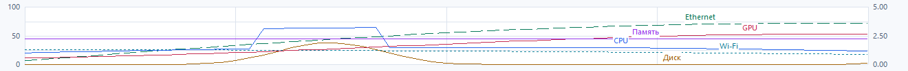

# Performance Glass

[日本語](../../README.md) · [English](README.en.md) · [简体中文](README.zh-Hans.md) · [繁體中文](README.zh-Hant.md) · [한국어](README.ko.md) · [Deutsch](README.de.md) · [Français](README.fr.md) · [Español](README.es.md) · [Português](README.pt.md) · [Italiano](README.it.md) · **Русский** · [Bahasa Indonesia](README.id.md)

Лёгкий монитор производительности для Windows 10 и 11 (x64). Один график показывает активность процессора, памяти, диска, Ethernet, Wi-Fi и GPU. Данные обновляются примерно раз в секунду.

Доступны интервалы 1, 10 и 60 минут, 6 и 12 часов. Приложение показывает частоту процессора, использование памяти, чтение и запись на диск, сетевой трафик, выделенную видеопамять и доступные температуры. Интерфейс учитывает масштаб, тему и язык Windows. Язык можно выбрать вручную.

## Скачать

Запустите последнюю версию `PerformanceGlass-v*-Windows-x64-Setup.exe`. По завершении нажмите **Да**, чтобы открыть приложение, или **Нет**, чтобы выйти. Настройки ZIP-версии сохраняются для той же учётной записи Windows. Установщик GitHub не подписан.

[GitHub Releases](https://github.com/nekomimiyks/PerformanceGlass/releases/latest) · [Microsoft Store](https://apps.microsoft.com/detail/9PJ34ZZHSD01)

Установщик создаёт ярлык на рабочем столе. В версии с GitHub можно включить автоматическую проверку обновлений через контекстное меню. По умолчанию она выключена. Нажмите **Обновить**, чтобы скачать, проверить и запустить установщик.

Температура процессора отображается, если текущие права позволяют читать данные работающего локального поставщика WMI. Помощник измерения температуры в версии с GitHub по умолчанию выключен. Установка PawnIO и запрос прав администратора предлагаются только при его ручном включении.

## Снимки экрана

На снимках показаны демонстрационные данные.

### Обычный (Тёмный)

### Обычный (Светлый)

### Только график (Тёмный)

### Только график (Светлый)

## Резервное копирование и восстановление настроек

Выберите **Сохранить резервную копию настроек** в контекстном меню, чтобы сохранить файл `.pgbackup`. Выберите **Восстановить настройки**, откройте файл и подтвердите применение параметров отображения. История измерений, автозапуск Windows и выбор прав администратора не входят в копию.

## Управление

- Дважды щёлкните по графику или нажмите `F11`, чтобы переключить рамку окна, сохранив размер и положение графика.
- Перетащите край или угол для изменения размера. Минимальный размер в режиме графика — 280 × 60 физических пикселей.
- Наведите курсор на график, чтобы увидеть значения. Щелчок правой кнопкой или `F10` открывает настройки истории, языка, графика на панели задач и области уведомлений. Режим области уведомлений выключен по умолчанию.

[Политика конфиденциальности (японский)](../privacy.md) · [Лицензия MIT](../../LICENSE) · [Уведомления о сторонних компонентах](../../THIRD_PARTY_NOTICES.txt)
