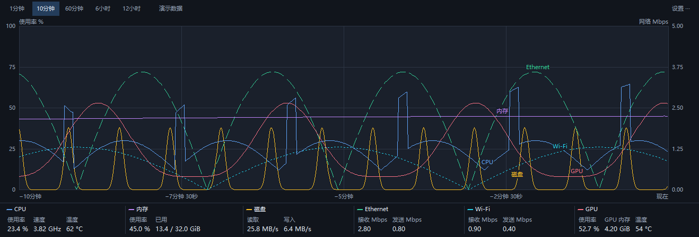
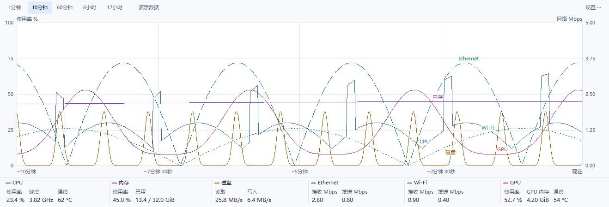
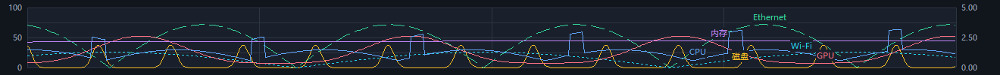
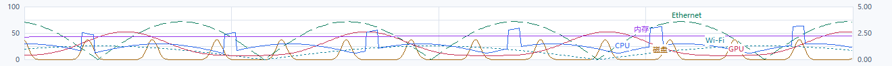

# Performance Glass

[日本語](../../README.md) · [English](README.en.md) · **简体中文** · [繁體中文](README.zh-Hant.md) · [한국어](README.ko.md) · [Deutsch](README.de.md) · [Français](README.fr.md) · [Español](README.es.md) · [Português](README.pt.md) · [Italiano](README.it.md) · [Русский](README.ru.md) · [Bahasa Indonesia](README.id.md)

适用于 Windows 10 和 11（x64）的轻量级桌面性能监视器。CPU、内存、磁盘、以太网、Wi-Fi 和 GPU 活动集中在一张图表中，约每秒更新一次。

可选择 1 分钟、10 分钟、60 分钟、6 小时或 12 小时的历史范围。支持查看 CPU 频率、内存用量、磁盘读写速度、网络流量、专用 GPU 显存及可获取的温度。应用会跟随 Windows 的缩放、主题和显示语言，也可手动切换语言。

## 下载

运行最新版 `PerformanceGlass-v*-Windows-x64-Setup.exe`。安装完成后，选择“是”启动应用，选择“否”直接退出。在同一个 Windows 用户下，原 ZIP 版的设置会保留。GitHub 安装程序未签名。

[GitHub Releases](https://github.com/nekomimiyks/PerformanceGlass/releases/latest) · [Microsoft Store](https://apps.microsoft.com/detail/9PJ34ZZHSD01)

在 GitHub 版中，右键选择 **监测 CPU 温度** 可启用随附的辅助程序。应用会在打开官方 PawnIO 安装程序或请求管理员权限前征询用户同意。Store 版可显示由本机兼容 WMI 提供程序提供的 CPU 温度。

## 屏幕截图

截图使用示例数据。

### 常规显示 (深色)

### 常规显示 (浅色)

### 仅显示图表 (深色)

### 仅显示图表 (浅色)

## 备份与恢复设置

右键单击并选择 **备份设置** 保存 `.pgbackup` 文件。选择 **恢复设置**，打开该文件并确认，即可应用保存的显示设置。备份不含监测历史、Windows 自启动设置及管理员权限选择。

## 操作

- 双击图表或按 `F11` 切换窗口边框，图表的大小和位置保持不变。
- 拖动窗口边缘或角落调整尺寸。仅显示图表时最小可缩至 280 × 60 物理像素。
- 将鼠标悬停在图表上可查看数值。右键单击或按 `F10` 可设置历史范围、语言、任务栏图表和系统托盘常驻。托盘常驻默认关闭。

[隐私政策（日文）](../privacy.md) · [MIT 许可证](../../LICENSE) · [第三方声明](../../THIRD_PARTY_NOTICES.txt)
