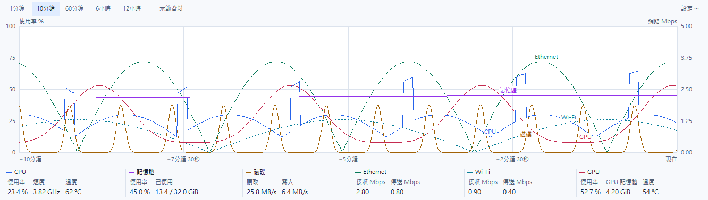
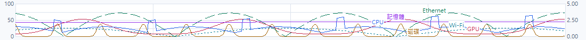

# Performance Glass

[日本語](../../README.md) · [English](README.en.md) · [简体中文](README.zh-Hans.md) · **繁體中文** · [한국어](README.ko.md) · [Deutsch](README.de.md) · [Français](README.fr.md) · [Español](README.es.md) · [Português](README.pt.md) · [Italiano](README.it.md) · [Русский](README.ru.md) · [Bahasa Indonesia](README.id.md)

適用於 Windows 10 和 11（x64）的輕量級桌面效能監視器。CPU、記憶體、磁碟、乙太網路、Wi-Fi 和 GPU 活動集中在同一張圖表，約每秒更新一次。

可選擇 1 分鐘、10 分鐘、60 分鐘、6 小時或 12 小時的歷程範圍。支援 CPU 時脈、記憶體用量、磁碟讀寫速度、網路流量、GPU 專用記憶體及可取得的溫度。介面會跟隨 Windows 的縮放、佈景主題及顯示語言，也可手動切換語言。

## 下載

完整解壓縮 Windows ZIP 後執行 `PerformanceGlass.exe`。基本監控不需要安裝或系統管理員權限。GitHub 版 EXE 尚未簽署。

[GitHub Releases](https://github.com/nekomimiyks/PerformanceGlass/releases/latest) · [Microsoft Store](https://apps.microsoft.com/detail/9PJ34ZZHSD01)

在 GitHub 版中，按滑鼠右鍵選擇 **監測 CPU 溫度** 可啟用隨附的輔助程式。開啟官方 PawnIO 安裝程式或要求系統管理員權限前，應用程式會先徵求同意。Store 版可顯示本機相容 WMI 提供者提供的 CPU 溫度。

## 畫面截圖

截圖使用範例資料。

| 顯示模式 | 深色 | 淺色 |
| --- | --- | --- |
| 一般顯示 |  |  |
| 僅顯示圖表 |  |  |

## 操作

- 按兩下圖表或按 `F11` 可切換視窗框線，並保留圖表的大小與位置。
- 拖曳邊緣或角落可調整視窗大小。僅顯示圖表時最小可縮至 280 × 60 實體像素。
- 將游標移到圖表上可查看數值。按滑鼠右鍵或 `F10` 可設定歷程範圍、語言、工作列圖表和系統匣常駐。常駐預設關閉。

[隱私權政策（日文）](../privacy.md) · [MIT 授權條款](../../LICENSE) · [第三方聲明](../../THIRD_PARTY_NOTICES.txt)
