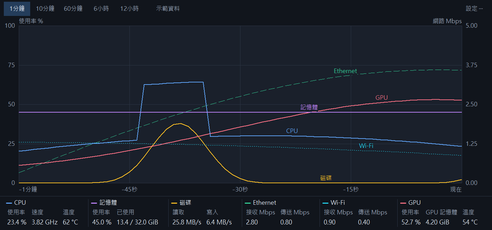
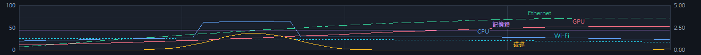

# Performance Glass

[日本語](../../README.md) · [English](README.en.md) · [简体中文](README.zh-Hans.md) · **繁體中文** · [한국어](README.ko.md) · [Deutsch](README.de.md) · [Français](README.fr.md) · [Español](README.es.md) · [Português](README.pt.md) · [Italiano](README.it.md) · [Русский](README.ru.md) · [Bahasa Indonesia](README.id.md)

適用於 Windows 10 和 11（x64）的輕量級桌面效能監視器。CPU、記憶體、磁碟、乙太網路、Wi-Fi 和 GPU 活動集中在同一張圖表，約每秒更新一次。

可選擇 1 分鐘、10 分鐘、60 分鐘、6 小時或 12 小時的歷程範圍。支援 CPU 時脈、記憶體用量、磁碟讀寫速度、網路流量、GPU 專用記憶體及可取得的溫度。介面會跟隨 Windows 的縮放、佈景主題及顯示語言，也可手動切換語言。

## 下載

執行最新版 `PerformanceGlass-v*-Windows-x64-Setup.exe`。安裝完成後，選擇「是」啟動應用程式，選擇「否」直接結束。使用同一個 Windows 帳戶時，原 ZIP 版的設定會保留。GitHub 安裝程式未簽署。

[GitHub Releases](https://github.com/nekomimiyks/PerformanceGlass/releases/latest) · [Microsoft Store](https://apps.microsoft.com/detail/9PJ34ZZHSD01)

安裝程式會建立桌面捷徑。在 GitHub 版中，可透過右鍵選單啟用預設關閉的自動更新檢查。發現新版本後，選擇 **更新** 即可下載、驗證並啟動安裝程式。

應用程式可用目前權限讀取執行中的本機相容 WMI 提供者時，會顯示 CPU 溫度。 GitHub 版的 CPU 溫度輔助功能預設關閉。只有手動啟用時，應用程式才會詢問是否安裝 PawnIO 或要求系統管理員權限。

## 畫面截圖

截圖使用範例資料。

### 一般顯示 (深色)

### 一般顯示 (淺色)

### 僅顯示圖表 (深色)

### 僅顯示圖表 (淺色)

## 備份與還原設定

按一下滑鼠右鍵，選擇 **備份設定**，儲存 `.pgbackup` 檔案。選擇 **還原設定**，開啟該檔案並確認，即可套用已儲存的顯示設定。備份不含監測記錄、Windows 自動啟動或系統管理員權限選擇。

## 操作

- 按兩下圖表或按 `F11` 可切換視窗框線，並保留圖表的大小與位置。
- 拖曳邊緣或角落可調整視窗大小。僅顯示圖表時最小可縮至 280 × 60 實體像素。
- 將游標移到圖表上可查看數值。按滑鼠右鍵或 `F10` 可設定歷程範圍、語言、工作列圖表和系統匣常駐。常駐預設關閉。

從右鍵選單開啟「關於此應用程式」，可查看目前執行的版本，以及發行者在 GitHub 和 Microsoft Store 上的應用程式連結。

[隱私權政策（日文）](../privacy.md) · [MIT 授權條款](../../LICENSE) · [第三方聲明](../../THIRD_PARTY_NOTICES.txt)
